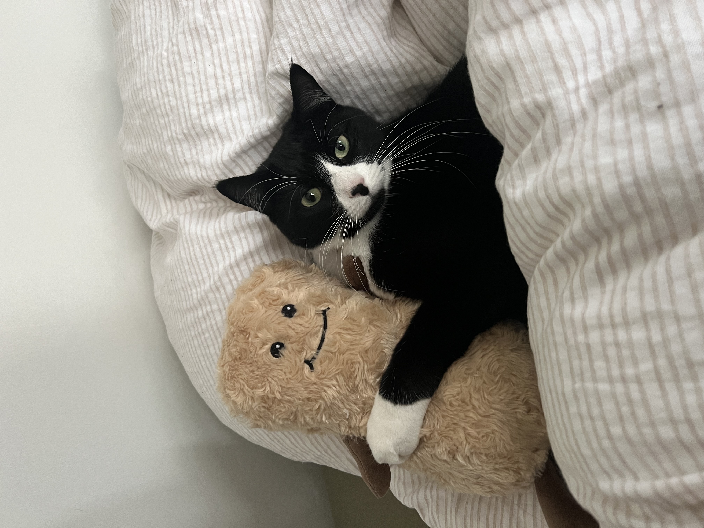
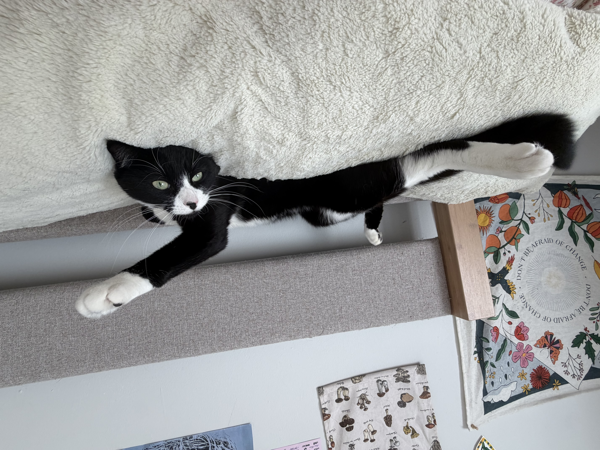

## Hi, I'm Natasha! 

Welcome to my personal website! 

I am currently a Master of Public Health student at Columbia University's Mailman School of Public Health. 

Prior to my MPH, I graduated with a BA in Neuroscience from Smith College. My research interests include studying how early childhood environments shape neurodevelopmental outcomes in children and adolescents. 

## Links

[Resume](resume.html)

[Dashboard](dashboard.html)

[GitHub](https://github.com/natashawoon)

[LinkedIn](https://www.linkedin.com/in/natasha-woon)

## About Me: 

I am from Singapore and moved to the United States for high school and college. 

In my free time, I enjoy reading, painting, live music and watching movies with friends! 

I also have a tuxedo kitty, Auggie! 

